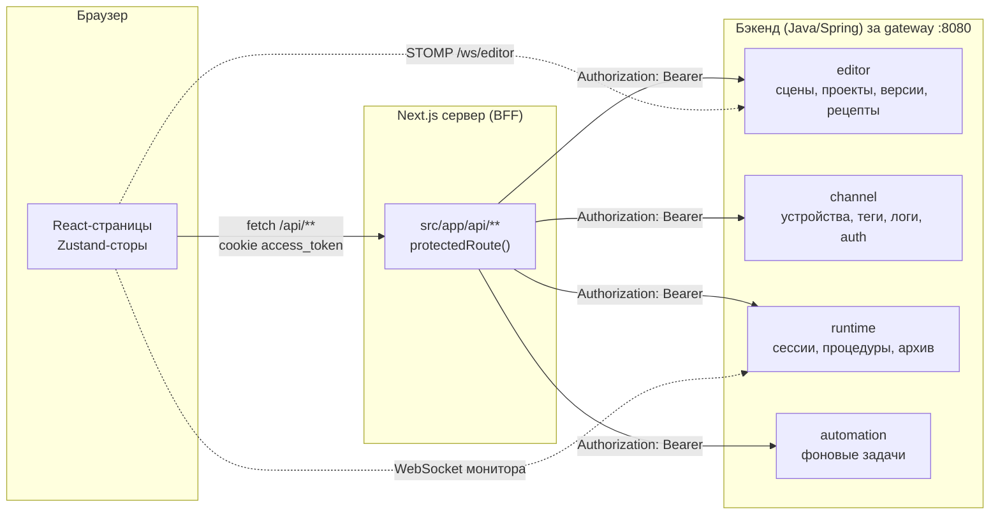

# SCADA Editor Frontend

Веб-интерфейс SCADA-системы: **редактор мнемосхем** для инженера, **монитор** для оператора
и сопутствующие разделы — база каналов, автоматизация, данные проекта, журналы,
администрирование.

Проект построен на **Next.js (App Router)** и работает одновременно как фронтенд и как
**BFF** (Backend-for-Frontend). Браузер ходит в доменный бэкенд (Java/Spring, через gateway)
не напрямую, а через внутренние роуты `src/app/api/**`. Эти роуты подставляют авторизацию из
httpOnly-cookie и проксируют запрос дальше. Исключение — живые соединения (WebSocket монитора
и STOMP редактора): они идут из браузера прямо в gateway.

> Язык кодовой базы — **русский**: комментарии, тексты интерфейса, сообщения об ошибках.

---

## Содержание

- [Разделы приложения](#разделы-приложения)
- [Технологический стек](#технологический-стек)
- [Архитектура](#архитектура)
- [Структура проекта](#структура-проекта)
- [Быстрый старт](#быстрый-старт)
- [Переменные окружения](#переменные-окружения)
- [Скрипты](#скрипты)
- [Сборка и деплой](#сборка-и-деплой)
- [Обзор BFF API](#обзор-bff-api)
- [Ключевые концепции](#ключевые-концепции)
- [Контракты с бэкендом](#контракты-с-бэкендом)
- [Документация](#документация)
- [Заметки для разработчиков](#заметки-для-разработчиков)

---

## Разделы приложения

Работа во всех разделах идёт в иерархии **Проект → Сцена (схема) → Элементы**. Проект
выбирается в шапке раздела. Навигация между разделами — иконки в шапке; название раздела
всплывает при наведении.

### 🖥️ Редактор схем — `/editor`

Основной инструмент инженера: здесь строятся мнемосхемы технологического процесса.

- **Холст на Konva** (`react-konva`): зум (Ctrl+колесо, щипок), панорамирование (колесо,
  Shift+колесо, средняя кнопка), рамка выделения, умные направляющие, привязка к сетке 20 px.
- **Элементы**:
  - графика — линия, кривая Безье, прямоугольник, круг, дуга, многоугольник, текст,
    изображение;
  - управление — кнопка, переключатель, ползунок, выпадающий список, поле ввода, чекбокс;
  - индикация — прогресс-бар, стрелочный прибор, таблица, тренд, график.
- **Группы и компоненты**: группировка и вложенные группы с «входом» внутрь. Группу можно
  превратить в логический **компонент** («Создать компонент»): её примитивы «запекаются» в
  изображение компонента, а дерево слоёв показывает только логические объекты. Действие
  обратимо («Разобрать»).
- **Состояния** («Нормальное», «Авария», …): у каждого свой набор визуальных свойств. Смена
  состояния распространяется по поддереву компонента по имени состояния.
- **Свойства, привязки, скрипты**:
  - свойства компонента — теговые и локальные, у каждого три имени: адрес для скриптов, имя
    для оператора и имя для шлюза;
  - JS-привязки «значение тега → вид элемента»;
  - прямая привязка тега к элементу, без кода;
  - скрипты событий (`onClick`, `onDoubleClick`);
  - серверные действия, которые можно вынести в меню монитора, с уровнем доступа.

  Синтаксис скриптов проверяется до сохранения.
- **Палитра шаблонов**: свой компонент можно сохранить в палитру и ставить на любые сцены.
- **Сохранение и версии**: автосохранение и ручное сохранение. У сцены есть история версий с
  предпросмотром и восстановлением. При одновременной правке сервер сливает изменения, а
  неразрешимые конфликты показываются в отдельном диалоге. Если сцену сохранил коллега,
  появляется уведомление (STOMP).
- **Выпуски проекта**: неизменяемый снимок всего проекта. Монитор показывает только выпуск,
  назначенный **prod**.
- **Закреплённые вкладки сцен**: общие для всех пользователей проекта.
- **Рамка вида монитора** (замок в панели зума): задаёт, какую область сцены увидит оператор.
- **Рецепты**: процедуры мойки из шагов (манифест тегов + шаги с условиями перехода), с
  историей версий. Принадлежат проекту и доходят до монитора только с выпуском.
- **Уровни процедур**: минимальный уровень оператора для запуска, подтверждения, паузы и
  остальных операций процедуры.
- **Импорт**: схемы из CONTUR, раскладка устройств из базы каналов, автопривязка тегов проекта
  к объектной базе каналов.

Подробное руководство пользователя — [`docs/editor-user-manual.md`](docs/editor-user-manual.md).

### 📺 Монитор — `/monitor`

Рабочее место оператора. Рисует **prod-выпуск** проекта (не черновик редактора) и оживляет
его значениями из runtime.

- **Живые значения** по WebSocket: сессия подписывается на открытую сцену. Привязки
  перерисовывают элементы; плохое качество тега показывается оверлеем «нет данных».
- **Меню компонента** (правый клик, на сенсорных панелях — обычное касание):
  - «Опции» — ручная запись значений тегов и свойств;
  - серверные действия;
  - «Открыть тренд».

  Скрипты `onClick` могут открывать сцены и показывать меню выбора.
- **Инспектор объектов**: любой объект prod-выпуска со всеми свойствами и живыми значениями.
- **Процедуры (рецепты)**: плавающий HUD поверх схемы и подробная вкладка «Процедуры».
  Операции: запуск, подтверждение шага, пауза и продолжение, переход к шагу, прерывание.
  Предупреждения о сбоях записи и зависших шагах приходят уведомлениями.
- **Тренды**: значения из архива тегов, отрисованные ступеньками; общая шкала с коэффициентами
  перьев; окно тренда с перемоткой.
- **Режим «Архив»**: проигрывание сцены по архиву тегов — плеер с перемоткой, схема рисуется
  так, как выглядела в выбранный момент.
- **Статусы фоновых задач** automation.
- **Права**: недоступные оператору действия не отправляются; причина отказа показывается в
  точке клика.

Монитор — наблюдатель, а не владелец процесса: проект исполняется, пока у него стоит флаг
«в эксплуатации», и закрытие вкладки ничего не останавливает.

### ⚙️ Автоматизация — `/automation`

Редактор фоновых задач проекта: задачи (JS), шаблоны задач, watchdog. Набор сохраняется
целиком и имеет историю версий. Исполняет задачи отдельный сервис automation — страница
только правит их определения.

### 🗃️ Данные проекта — `/data`

Два документа с отдельными версиями:

- **таблицы** — серверные скрипты читают их через `data()`;
- **переменные проекта** — в привязках к ним обращаются как к `@var.<имя>`.

Кнопка «Применить данные» просит automation перечитать сохранённое.

### 🗄️ База каналов — `/channels`

- Дерево «площадка → проект → устройство → каналы» (`rc-tree`) с поиском.
- Просмотр и правка параметров устройства, черновики в `localStorage`.
- **Блокировки редактирования** (Redis на бэкенде): при входе в режим правки узлы
  блокируются. Блокировка снимается при выходе из режима, при SPA-навигации и при закрытии
  страницы (`useUnlockEditingOnUnload`).
- Импорт базы из `.cdbx` с отчётом, экспорт конфигурации для шлюза.

### 📜 Логирование — `/log`

Просмотр системных логов с фильтрами.

### 📋 Журнал действий — `/actions`

Действия операторов: нажатия в мониторе, операции процедур, ручные записи тегов. Только
чтение, с фильтрами по времени и пользователю.

### 🛡️ Администрирование — `/admin`

Только для администратора:

- пользователи;
- их права в проектах: `view` / `operate` / `edit` и уровень 1–10;
- ветки каталога проекта — какие узлы базы каналов видят его пользователи;
- перепубликация прав.

Самостоятельной регистрации нет — пользователей заводит администратор.

### 🔐 Вход — `/login`

Токен хранится в httpOnly-cookie `access_token`. `src/proxy.ts` перенаправляет
неавторизованных пользователей на `/login`, а авторизованных — из корня в рабочую область.

---

## Технологический стек

| Слой | Технологии |
|------|-----------|
| Framework | **Next.js 16.1** (App Router, Turbopack, `output: 'standalone'`), **React 19.2** |
| Язык | **TypeScript 5** |
| Стили | **Tailwind CSS 4**, `next-themes` (светлая/тёмная тема), Radix UI, `tw-animate-css` |
| Состояние | **Zustand 5** (+ **zundo** для undo/redo в редакторе), TanStack Query |
| Холст | **Konva 10** / `react-konva`, `react-konva-utils`, `react-rnd` |
| Формы / валидация | `react-hook-form`, `zod` |
| Дерево / DnD | `rc-tree`, `@dnd-kit/core`, `@dnd-kit/sortable` |
| Редактор кода | `@uiw/react-codemirror` (JavaScript) |
| Реалтайм | нативный WebSocket (монитор), `@stomp/stompjs` + `sockjs-client` (уведомления редактора) |
| UI-утилиты | `lucide-react`, `sonner` (тосты), `clsx`, `tailwind-merge`, `framer-motion` |
| Тулинг | ESLint 9, Prettier, Husky + lint-staged |

---

## Архитектура



**Авторизация.** `POST /api/auth/login` получает токен у бэкенда и кладёт его в
httpOnly-cookie `access_token` (`src/lib/setTokenCookies.ts`). Флаг `Secure` выставляется по
протоколу *запроса*, а не по `NODE_ENV`: стенд и Docker-сборка — production, но работают по
http. Каждый роут, который ходит в бэкенд, обёрнут в `protectedRoute`
(`src/lib/protected.ts`): он читает cookie и передаёт `Authorization: Bearer …`.
`src/lib/access/authInterceptor.ts` перехватывает `fetch` и при `401` (или отключённом
пользователе) уводит на `/login`.

**Живые соединения идут мимо BFF.** Адрес gateway строится из **хоста страницы** и порта
8080 (`src/lib/gatewayOrigin.ts`). Поэтому одна и та же сборка работает с любого компьютера
сети, а cookie `access_token` (общая для хоста, не для порта) доходит до gateway.

**Права доступа.** В каждом проекте у пользователя есть `view` / `operate` / `edit` и уровень
1–10; администратор может всё. Права приходят со списком проектов (`src/lib/access/`).
Интерфейс прячет то, в чём бэкенд всё равно откажет, но защищает именно бэкенд: проверки на
фронте — только удобство.

**Черновик и выпуск.** Редактор правит черновик проекта. Монитор показывает только
prod-выпуск — неизменяемый снимок. Рецепты, уровни процедур и уровни скриптов тоже доходят
до монитора только с новым выпуском.

**Состояние.** По Zustand-стору на область: `useEditorStore` (сцена, элементы, undo через
zundo), `usePaletteStore`, `useDeviceStore`, `useLogsStore`, процедуры (`useProcedureStore`,
`useRecipeStore`, `useMonitorRecipesStore`), тренды и архив (`useTrendStore`,
`useArchiveReplayStore`) и другие. Модальные окна открываются через `modalStore` + `ModalRoot`.

---

## Структура проекта

```
src/
├── app/
│   ├── (app)/                  # Рабочая область (за авторизацией), общая шапка в layout.tsx
│   │   ├── editor/             # Редактор схем (EditorClient)
│   │   ├── monitor/            # Монитор оператора (MonitorClient)
│   │   ├── automation/         # Фоновые задачи проекта
│   │   ├── data/               # Таблицы и переменные проекта
│   │   ├── channels/           # База каналов
│   │   ├── log/                # Логи
│   │   ├── actions/            # Журнал действий оператора
│   │   └── admin/              # Администрирование
│   ├── (auth)/login/           # Вход
│   ├── api/                    # BFF: прокси к бэкенду (см. «Обзор BFF API»)
│   └── providers.tsx           # Тема, тосты, перехватчик авторизации
│
├── components/
│   ├── editor/                 # Редактор: Canvas, панели, палитра, свойства, версии, выпуски
│   │   └── canvas/             # Рендер холста: shapes/*, hooks/*, контекст рендера
│   ├── monitor/                # HUD процедур, тренды, инспектор, архивный плеер, окна «Опций»
│   ├── automation/             # Редактор задач и шаблонов, история версий
│   ├── projectData/            # Таблицы и переменные проекта
│   ├── channels/               # Дерево устройств, параметры, импорт/экспорт
│   ├── logs/ · auth/
│   └── ui/                     # Общие компоненты и модалки
│
├── store/                      # Zustand-сторы
├── lib/
│   ├── editor/                 # Чистая логика редактора: геометрия, кэш сцен, версии, выпуски
│   ├── runtime/                # Движок монитора: WS, привязки, процедуры, архив
│   ├── access/                 # Права, перевод отказов, перехватчик 401
│   ├── automation/ · projectData/
│   ├── buildComponentTree.ts   # Сохранение: плоский массив → дерево DTO
│   ├── transformElements.ts    # Загрузка: дерево DTO → плоский массив
│   └── protected.ts            # protectedRoute для BFF-роутов
├── constants/                  # Палитра, панель свойств, контекстные меню
├── types/                      # Типы предметной области
└── proxy.ts                    # Редиректы по наличию токена

docs/
├── contract/                   # Контракты с бэкендом (по датам)
├── contur/                     # Материалы по импорту из CONTUR
└── editor-user-manual.md       # Руководство пользователя редактора

scripts/copy-standalone-assets.mjs   # postbuild: статика в .next/standalone
Dockerfile · DEPLOY.md · CLAUDE.md
```

Чтобы разобраться в редакторе, начните с этих файлов:
`src/types/editorElement.type.ts`, `src/store/useEditorStore.ts`,
`src/lib/buildComponentTree.ts` ↔ `src/lib/transformElements.ts`,
`src/components/editor/canvas/`. Для монитора — `src/lib/runtime/useRuntimeEngine.ts`.

---

## Быстрый старт

### Требования

- **Node.js 20+** и npm.
- Запущенный бэкенд с gateway (по умолчанию `http://localhost:8080`). Без него приложение
  откроется, но войти и что-либо загрузить не получится.

### Установка и запуск

```bash
# 1. Зависимости (заодно ставит git-хуки husky)
npm install

# 2. Локальные переменные окружения
cp .env.example .env.local

# 3. Dev-сервер (Turbopack)
npm run dev
```

Откройте **http://localhost:3000** и войдите под пользователем, которого завёл
администратор. Для монитора нужен проект с prod-выпуском и включённым флагом «в эксплуатации».

---

## Переменные окружения

Задаются в `.env.local` (в git не попадает, образец — [`.env.example`](.env.example)).

| Переменная | Где читается | Назначение | По умолчанию |
|------------|-------------|-----------|--------------|
| `BACKEND_URL` | сервер (BFF) | Устройства, каналы, логи, авторизация, блокировки; запасной адрес для runtime и automation | `http://localhost:8080` |
| `BACKEND_URL_EDITOR` | сервер (BFF) | API редактора: сцены, компоненты, проекты, версии, рецепты, автоматизация, данные. Должен указывать на **gateway**: часть запросов требует заголовок `X-Username`, а его ставит только gateway | `http://localhost:8080` |
| `BACKEND_URL_RUNTIME` | сервер (BFF) | Runtime: сессии монитора, запись тегов, процедуры, архив | `BACKEND_URL` |
| `BACKEND_URL_AUTOMATION` | сервер (BFF) | Сервис automation: статусы задач, перечитывание данных | `BACKEND_URL` |
| `NEXT_PUBLIC_GATEWAY_PORT` | браузер | Порт gateway для живых соединений | `8080` |
| `NEXT_PUBLIC_GATEWAY_URL` | браузер | Полный адрес gateway для STOMP редактора (переопределение) | хост страницы + порт |
| `NEXT_PUBLIC_RUNTIME_WS_URL` | браузер | Полный адрес WebSocket монитора (переопределение) | хост страницы + порт |

> ⚠️ `NEXT_PUBLIC_*` **вшиваются в сборку**, а Docker-образ общий для всех установок. Задавайте
> их только для переопределения. По умолчанию браузер берёт хост из адреса страницы — поэтому
> никогда не прописывайте туда `localhost`: с другого компьютера это будет сам клиент.

---

## Скрипты

| Команда | Действие |
|---------|----------|
| `npm run dev` | Dev-сервер (Turbopack) на `:3000` |
| `npm run build` | Продакшн-сборка в режиме `standalone`; `postbuild` копирует `.next/static` и `public` в `.next/standalone` |
| `npm run start` | Запуск собранного приложения: `node .next/standalone/server.js` |
| `npm run lint` | ESLint |

Перед коммитом **Husky + lint-staged** прогоняют `eslint --fix` и `prettier --write` по
изменённым `*.{js,ts,tsx}`.

---

## Сборка и деплой

### Docker

Многостадийный [`Dockerfile`](Dockerfile): `deps` → `builder` (`npm run build`) → `runner`
на `node:20-alpine` со standalone-выводом. Сервер слушает порт **3000**. Переменные
`BACKEND_URL*` передаются при запуске контейнера (например, через docker-compose), в образ они
не вшиваются.

```bash
docker build -t scada-editor-frontend .
docker run -p 3000:3000 \
  -e BACKEND_URL=http://gateway:8080 \
  -e BACKEND_URL_EDITOR=http://gateway:8080 \
  scada-editor-frontend
```

### Linux (systemd + nginx)

Пошаговый runbook — [`DEPLOY.md`](DEPLOY.md).

---

## Обзор BFF API

Все роуты лежат в `src/app/api/` и проксируют запросы в бэкенд с Bearer-токеном. Ошибки
бэкенда, как правило, передаются клиенту как есть: интерфейс показывает `message` и
переводит отказы по правам (`{error: "FORBIDDEN", reason}`).

| Группа | Назначение |
|--------|-----------|
| `auth/*` | Вход, выход, текущий пользователь, админ-API пользователей и прав |
| `editor/scene`, `editor/components` | Чтение сцены и сохранение (`PUT` всей сцены с `based_on_version`) |
| `editor/project`, `editor/projects/[projectId]/*` | Проекты: выпуски и версии, флаг «в эксплуатации», настройки (закреплённые сцены), автопривязка, рецепты, уровни процедур |
| `editor/history/[docType]/[id]/*` | История версий: сцены, шаблоны, automation, данные, проекты, рецепты |
| `editor/palette`, `editor/tags` | Палитра шаблонов, переименование сохранённых свойств |
| `editor/automation*`, `editor/data` | Набор задач automation и его шаблоны, таблицы данных проекта |
| `runtime/sessions` | Сессии монитора (адрес WebSocket выдаёт ответ) |
| `runtime/projects/[projectId]/*` | Prod-выпуск для монитора: сцены, объекты, рецепты, уровни процедур, запись свойств |
| `runtime/recipes/[id]/*` | Процедуры: `start` / `status` / `confirm` / `pause` / `resume` / `jump` / `abort` |
| `runtime/tags/write` | Запись тега из монитора |
| `runtime/archive/*` | Архив тегов: значения для трендов и проигрывание |
| `runtime/actions` | Журнал действий оператора |
| `automation/projects/*` | Статусы задач, перечитывание данных |
| `device/*`, `lock`, `unlock` | База каналов: иерархия, параметры, шаблоны, импорт/экспорт, блокировки |
| `logs/*` | Логи |

---

## Ключевые концепции

Кратко — самое важное, без чего код трудно читать. Подробности, причины решений и подводные
камни описаны в [`CLAUDE.md`](CLAUDE.md).

- **Плоский массив элементов.** Сцена — это `elements: DiagramElement[]` без вложенности.
  Иерархия задаётся ключами: `parentKey` — контейнер элемента, `children` — логические
  компоненты, `composition` — примитивы, из которых нарисован компонент.
- **Состояния и overrides.** Визуальные свойства листовых элементов лежат в `overrides`
  текущего состояния. Рендерить и измерять элемент нужно только через `getRenderedElement(el)`.
  У групп координаты хранятся в базовом элементе.
- **Сетка 20.** Всё, что задаёт позицию или размер, привязывается к сетке в мировых
  координатах (`snap` в `src/lib/utils.ts`).
- **Сериализация туда и обратно.** При сохранении `buildComponentTree` «запекает» примитивы
  компонента в JSON `states[].image`. При загрузке `transformElements` их распаковывает. Обе
  стороны должны оставаться симметричными; серверные id вложенных сущностей обязаны
  переживать полный цикл сохранения и загрузки.
- **Версии вместо отмены на сервере.** Сохранение отправляет сцену целиком вместе с
  `based_on_version`. Ответ `409` означает конфликт, а не ошибку: ручное сохранение открывает
  диалог слияния, автосохранение — баннер. Ctrl+Z работает локально (zundo) и с версиями не
  связан.
- **Кэш сцен.** Сцены проекта предзагружаются в память вкладки, поэтому переключение
  мгновенное. Кэш проверяется на актуальность по номеру версии.
- **Монитор и WS.** Сессия подписывается на открытую сцену. При смене сцены привязки
  обязательно перезапускаются. Первый кадр — `SNAPSHOT`. События процедур идут мимо
  буфера значений.
- **Процедуры.** Опрос статуса и уведомления живут в `useProcedureSync`, который смонтирован
  **ровно один раз** в `MonitorClient`. HUD и вкладка — только представление.

---

## Контракты с бэкендом

Договорённости о каждом API, которые меняли фронт и бэкенд вместе, лежат в
[`docs/contract/`](docs/contract/). Имя файла — `ГГГГ-ММ-ДД-тема-contract.md`. Внутри: пути,
тела, коды ответов, что изменилось и где это во фронте. При изменении API сначала обновите
или добавьте контракт, затем код. Примеры:

- `2026-09-29-project-release-contract.md` — выпуски проекта и prod;
- `2026-10-08-ws-scene-subscription-contract.md` — подписка WS на сцену;
- `2026-10-15-access-roles-contract.md` — роли доступа;
- `2026-10-19-recipes-in-project-contract.md` — рецепты в проекте и выпуске.

---

## Документация

| Файл | Для кого |
|------|----------|
| [`docs/editor-user-manual.md`](docs/editor-user-manual.md) | Пользователь редактора: интерфейс, элементы, горячие клавиши |
| [`CLAUDE.md`](CLAUDE.md) | Разработчик (и ИИ-ассистент): архитектура, инварианты, подводные камни |
| [`DEPLOY.md`](DEPLOY.md) | Деплой на Linux: systemd, nginx |
| [`docs/contract/`](docs/contract/) | Контракты API с бэкендом |

---

## Заметки для разработчиков

- **Тестов нет**: тестовый раннер не настроен. Проверка — `npm run lint`, `tsc` и ручной
  прогон в `npm run dev`.
- **Ошибки типов.** `npx tsc --noEmit` выдаёт стабильный набор старых ошибок: объединение
  `ElementType` неполное. `next build` их игнорирует (`typescript.ignoreBuildErrors` в
  `next.config.ts`). Правило: **не добавлять новых ошибок** сверх этого набора.
- **Русский язык** в комментариях и текстах интерфейса — придерживайтесь его.
- **Guard-ы иерархии.** Операции со сценой проверяют, что она принадлежит текущему проекту
  (`sceneBelongsToCurrentProject`). Не убирайте эти проверки.
- **Обход дерева элементов.** Геометрия ходит по `parentKey`. Жизненный цикл (удаление,
  копирование, состояния) — по `[...children, ...composition]`. Логическое дерево и
  сериализация — только по `children`.
- **Хуки с эффектами монтируются один раз**: `useProcedureSync` и `useArchiveReplay` — только
  в `MonitorClient`, `useSceneChangedNotifications` — только в `EditorClient`. Второй экземпляр
  даст двойной опрос и двойные уведомления.
- **Проверка сериализации без браузера**: транспилировать `buildComponentTree`,
  `transformElements` и `createUuid` через `npx tsc --module commonjs` и прогнать цикл в
  Node-скрипте.
- **Git**: разработка ведётся в ветке `dev`, стабильное состояние — `main`.
